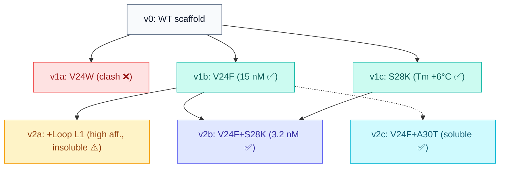

  
04

  
Campaign lineage DAG

  
Why raw papers confuse LMs — and how we build the graph

<!--
Speaker Notes:
So far we focused on representing a single engineering step.
In this section, we look at why extracting those steps directly from raw paper prose is hard for language models, how we reconstruct the lineage graph deterministically without an LLM, and what the full campaign DAG gives us.
-->

---
transition: slide-left
---

# Raw papers are hard for LMs to navigate

Papers are written as a narrative for humans, not as a chronological log of experiments.

  

    
How a paper is actually written

    

      
Abstract: spoils the final winner (<code>v2.0</code>, 3.2 nM) upfront

      
Results §2: jumps straight to winning edits (<code>V24F</code>, <code>S28K</code>)

      
Results §4: mentions an earlier dead-end (<code>V24W</code> clash) in passing

      
Supplement S3: buries 12 failed variants and full sequences

    

  

  

    
Why an LM gets lost

    

      

        
Non-linear order

        
Hard to tell which failure happened <i>before</i> which design decision.

      

      

        
Built-in answer leakage

        
Final outcomes sit right next to early hypotheses.

      

      

        
Branching &amp; alias drift

        
The same variant appears as <code>clone 4</code>, <code>v1.2</code>, or <code>V24F</code> across parallel paths.

      

    

  

  Before extracting scientific reasoning, we need the backbone: which variant came from which.

<!--
Speaker Notes:
A key practical obstacle is that scientific papers are optimized for storytelling, not chronological tracking.
The abstract spoils the winner, failed attempts appear pages later or in supplements, and variant names drift across sections.
If we ask an LM to build the experiment tree directly from prose, it easily confuses order and leaks outcomes.
-->

---
transition: slide-left
---

# Grounding every claim in evidence

Mandatory sentence-level citations — the LLM must point to an exact span for every fact it extracts.

  

    

      
1. Number the paper (script, no LLM)

      
Split prose, tables, and captions into indexed spans <code>[E1..En]</code>.

    

    

      <pre class="m-0 px-3 py-2 rounded bg-slate-50 border border-slate-200 font-mono text-[10.5px] text-slate-700 leading-snug whitespace-pre-wrap">[E12] "Minibinder_v1.2 bound patch 365–380 at 450 nM; cavity near Tyr369."
[E14] "V24W clashed with helix-2 and abolished binding."
[E19] "Table 1: Minibinder_v2.0 (V24F+S28K) | Kd = 3.2 nM"</pre>
    

  

  

    

      
2. Extract claim + pointer (LLM)

      
Every extracted field or edge must cite the exact <code>[E#]</code> it came from.

    

    

      <pre class="m-0 px-3 py-2 rounded bg-slate-50 border border-slate-200 font-mono text-[10.5px] text-slate-700 leading-snug whitespace-pre-wrap">diagnosis: "cavity near Tyr369"  → [E12]
edge(WT → V24W): clash            → [E14]
outcome: Kd = 3.2 nM              → [E19]</pre>
    

  

  

    

      
3. Verify 1-to-1 (check / filter)

      
Check one claim against one span; unsupported claims are dropped or marked inferred.

    

    

      <pre class="m-0 px-3 py-2 rounded bg-slate-50 border border-slate-200 font-mono text-[10.5px] text-slate-700 leading-snug whitespace-pre-wrap">does [E14] support "V24W clashed"? → ✓ (stated)
no direct [E#] for edge            → inferred / drop</pre>
    

  

<!--
Speaker Notes:
Here is how evidence-based extraction works in three simple steps:
1. A deterministic script—no LLM—splits the paper, tables, and captions into numbered spans [E1..En].
2. The LLM extracts each field or edge as a claim paired with its exact [E#] pointer.
3. Verification becomes a fast 1-to-1 check: one claim against one sentence. Anything without direct textual support is either dropped or explicitly flagged as inferred rather than stated.
-->

---
transition: slide-left
---

# Building a candidate parent graph

Sequence diffs propose candidate edges; paper prose confirms what actually happened.

  

    

      
1. Collect variants

      
Pull sequences or mutation strings from tables, FASTA, and supplements.

    

    

      <pre class="m-0 px-3 py-2 rounded bg-slate-50 border border-slate-200 font-mono text-[11px] text-slate-700 leading-relaxed">WT, V24W, V24F, S28K, V24F+S28K</pre>
    

  

  

    

      
2. Sequence diff → candidate edges

      
Minimal mutation supersets propose candidate parent and merge links — without assuming subset inclusion equals true history.

    

    

      <pre class="m-0 px-3 py-2 rounded bg-slate-50 border border-slate-200 font-mono text-[11px] text-slate-700 leading-snug">WT ─▶ {V24F} ─┐
              ├─▶ {V24F, S28K}
WT ─▶ {S28K} ─┘
edge types: stated | inferred | unresolved</pre>
    

  

  

    

      
3. Ground with prose &amp; rounds

      
An LLM checks paper text to confirm edges, recover round order, and attach diagnosis, rationale, and failure causes.

    

    

      <pre class="m-0 px-3 py-2 rounded bg-slate-50 border border-slate-200 font-mono text-[11px] text-slate-700 leading-relaxed">WT → V24W [stated, round 1] ⇐ [E14]</pre>
    

  

  Explicit uncertainty: sequence diffs propose the backbone; paper text separates confirmed lineage from inferred links.

<!--
Speaker Notes:
We do not pretend mutation subset inclusion alone proves the true experimental history, nor do we ask an LLM to invent the graph from scratch.
Instead, we collect variants and use sequence diffs to propose a candidate parent graph.
Then an LLM grounds those candidate edges in the paper text—confirming stated parents, flagging uncertain links, recovering round order, and attaching the scientific rationale.
-->

---
transition: slide-left
---

# What the campaign DAG unlocks

Nodes are variants; each edge is one structured step from Section 03.

  

    
Leak-free negative history

    
Only failures from confirmed earlier rounds enter <code>failed attempts</code> — parallel siblings from the same round do not leak.

  

  

    
Recombination &amp; epistasis

    
Two-parent edges (<code>v1b + v1c → v2b</code>) capture synergy vs. negative epistasis.

  

  

    
Campaign-level search

    
Show a half-explored DAG and ask: <i>which branch to expand next, which to prune?</i>

  

<!--
Speaker Notes:
Once we have the campaign DAG and round order, three things fall out naturally:
1. Only failures from confirmed earlier rounds enter negative history, preventing leakage from parallel siblings tested in the same round. Notice also that non-winning leaves are not always hard failures—some represent partial successes or constraint tradeoffs like high affinity but poor solubility.
2. Two-parent merges model recombination and epistasis directly.
3. Beyond single-step tasks, we can evaluate campaign-level search by showing a partially explored DAG and asking which branch to pursue next.
-->
